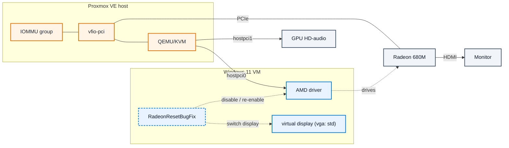

# Proxmox iGPU passthrough

<p align="center">
  <picture>
    <source media="(prefers-color-scheme: dark)" srcset="docs/assets/logo-dark.svg?v=1">
    
  </picture>
</p>

Notes from a working Ryzen 9 6900HX (Radeon 680M) passthrough on Proxmox VE 8.4:
the configuration, a read-only check script, and the problems that only appear
after the first boot.

  

<!-- Screenshot: save docs/assets/device-manager.png (see docs/assets/README.md) -->

**Jump to:** [Setup](#1-enable-iommu) · [Known limitations](#known-limitations) · [Troubleshooting](#troubleshooting) · [Hardware matrix](docs/hardware-matrix.md)

## Who this is for

- You have an iGPU to pass through (tested here on an AMD APU, Radeon 680M) and want
  Windows 11 on the physical monitor via Proxmox VE.
- You followed a guide once and hit Error 43, a black screen, or a VM that would not start
  after a reboot.
- You want to know which failures are hardware limits and which are fixable.

This is an independent write-up. It was inspired by
[isc30/ryzen-gpu-passthrough-proxmox](https://github.com/isc30/ryzen-gpu-passthrough-proxmox),
which carries no license, so no text is copied here; the steps are retested on a newer
stack (PVE 8.4, QEMU 9.x, kernel 6.8, Windows 11, OVMF).

## How it fits together



The host kernel keeps the GPU on `vfio-pci`; the guest borrows it through QEMU (the IOMMU
isolates it). With the framebuffer blacklisted the host has **no display path of its own**,
so the monitor is dark until a guest owns the Radeon. The reset service runs inside Windows
and switches between the Radeon and the virtual adapter around shutdown/startup.

New to the terms? [Glossary](docs/glossary.md).

## Tested on

| Component | Version / hardware |
| --------- | ------------------ |
| Mini-PC | Beelink EQR6 (EQR6-D5, socketed RAM), BIOS `FP7T107` |
| CPU / APU | Ryzen 9 6900HX (Radeon 680M, `1002:1681` and HD audio `1002:1640`) |
| Hypervisor | Proxmox VE 8.4.x, kernel 6.8.x-pve, QEMU 9.2 |
| Guest | Windows 11, OVMF (`pc-q35` machine), VirtIO drivers |
| Display | HDMI from the APU; the Radeon is the primary display, plus a virtual GPU for the reset service (`vga: std`) |
| Reboots | In-place Windows restart/shutdown with RadeonResetBugFix and a virtual GPU |

## Compatibility at a glance

| iGPU | Generation | Example APUs | Status |
| ---- | ---------- | ------------ | ------ |
| Radeon 680M | RDNA2 (Rembrandt) | 6900HX, 7735HS, 6800H | Tested (6900HX / EQR6) |
| Radeon 780M | RDNA3 (Phoenix / Hawk Point) | 7840HS, 7940HS, 8845HS | Same path, not verified here |
| Radeon 760M | RDNA3 (Phoenix) | 7640HS | Same path, not verified here |
| Radeon 660M | RDNA2 (Rembrandt) | 6600H | Same path, not verified here |

"Same path" means the same IOMMU, vfio, q35 and OVMF steps apply. It is not a
compatibility promise: ROM extraction and reset behaviour still need to be confirmed on
each machine, and that is what the [hardware matrix](docs/hardware-matrix.md) records.
Add a row by pull request, or ask in
[Discussions](https://github.com/ogabelopes/proxmox-igpu-passthrough/discussions).

## TL;DR

1. Enable AMD-Vi/IOMMU in firmware; add `iommu=pt` (and `amd_iommu=on`) to the kernel cmdline.
2. Bind the GPU and its HD-audio function to `vfio-pci` at boot.
3. Extract the VBIOS from the host's `VFCT` ACPI table and place it in `/usr/share/kvm/`.
4. Create a q35 + OVMF Windows VM with `vga: none`.
5. Pass the GPU with `romfile=<vbios>`. With OVMF, Error 43 usually needs the AMD GOP ROM on the audio function as well.
6. Install the VirtIO guest tools, the offline AMD driver, and RadeonResetBugFix.
7. Run [scripts/check-passthrough.sh](scripts/check-passthrough.sh) and test a guest reboot.

## Requirements

- Proxmox VE 8.4 or newer.
- A CPU and board with working IOMMU grouping for the iGPU.
- BIOS configured for passthrough — see [docs/bios.md](docs/bios.md).
- Physical access to the machine at least once (see [why the host has no console](docs/why-no-local-console.md)).
- Time: some failures only appear on the second boot.

## Copy a working config

The tested files are in [examples/](examples/README.md): the VM config, `vfio.conf`,
`/etc/modules` and the GRUB line. They are templates with placeholders; review before
applying.

## 1. Enable IOMMU

*Why: without IOMMU groups the kernel cannot isolate the GPU for assignment.*

Enable IOMMU / AMD-Vi in the firmware (keep SVM on). Then add to the kernel cmdline in
`/etc/default/grub`:

```text
amd_iommu=on iommu=pt
```

```bash
update-grub && update-initramfs -u -k all
```

After a reboot, confirm the groups exist:

```bash
ls /sys/kernel/iommu_groups | wc -l   # must be greater than 0
```

## 2. Bind the GPU to vfio-pci at boot

*Why: vfio-pci must claim the GPU before amdgpu/radeon initialise it.*

Find the function IDs. Your BDFs will differ:

```bash
lspci -nn | grep -i 'vga\|audio'
# 0000:XX:00.0 VGA compatible controller [0300]: ... [1002:xxxx]
# 0000:XX:00.1 Audio device [0403]: ... [1002:yyyy]
```

Create `/etc/modprobe.d/vfio.conf`:

```text
options vfio-pci ids=1002:xxxx,1002:yyyy disable_vga=1
softdep radeon pre: vfio-pci
softdep amdgpu pre: vfio-pci
softdep snd_hda_intel pre: vfio-pci
```

Create `/etc/modules`:

```text
vfio
vfio_iommu_type1
vfio_pci
```

> [!NOTE]
> `vfio_virqfd` appears in many older guides. It was folded into `vfio` in kernel 5.19
> and is no longer a loadable module. Listing it is harmless but misleading.

```bash
update-initramfs -u -k all && reboot
lspci -k -s XX:00.0   # "Kernel driver in use: vfio-pci"
```

## 3. Extract the VBIOS

*Why: the guest firmware needs the GPU's own option ROM to post a display.*

The guest needs the GPU's option ROM. On an APU the VBIOS can be recovered from the host's
`VFCT` ACPI table. The script does it read-only:

```bash
sudo ./scripts/extract-vfct.py --output-dir /tmp/vbios
sudo cp /tmp/vbios/vbios_*.bin /usr/share/kvm/
```

It prints the PCI ID and size; on the tested machine the result is byte-identical to the ROM
the host uses. The approach comes from matt22207's gist and the original guide (see
[Credits](#credits)).

> [!WARNING]
> Do not redistribute vendor firmware blobs in a public repo. Extract them on the machine
> that owns the hardware.

## 4. Create the VM

*Why: q35 and OVMF are what the passthrough and the ROM path expect.*

- OS type: Windows 11, Machine: q35, BIOS: OVMF (UEFI). Add a TPM if you want BitLocker or
  the Windows 11 requirements.
- CPU: `host`, with `args: -cpu 'host,-hypervisor,kvm=off'` in the VM config so the guest
  does not detect the hypervisor.
- Disk: VirtIO SCSI, `discard=on`, `ssd=1`.
- Display: `vga: std`. The virtual GPU is required by the reset service in step 6 (it needs a
  second adapter to switch to while it disables the Radeon).

## 5. Attach the GPU and the audio function

*Why: the Radeon must be the primary display, and the audio function must follow it or Windows reports Error 43.*

In `/etc/pve/qemu-server/<VMID>.conf`:

```text
hostpci0: 0000:XX:00.0,pcie=1,romfile=vbios_6900HX.bin,x-vga=1
hostpci1: 0000:XX:00.1,pcie=1,romfile=AMDGopDriver.rom
vga: std
```

- `x-vga=1` makes the passthrough GPU the primary display. If a cold boot then shows
  nothing, remove it and retest; some firmware and OVMF combinations do not need it.
- The audio function normally needs no ROM. With OVMF, Error 43 is often fixed by giving it
  a GOP ROM (`AMDGopDriver.rom`), extracted from your own hardware.
- Keep the virtual GPU (`vga: std`). RadeonResetBugFix needs a second adapter: if you set
  `vga: none`, it cannot disable the Radeon and `qm shutdown` hangs.

> [!NOTE]
> **What "Error 43" means.** Device Manager shows *"Windows has stopped this device because
> it has reported problems. (Code 43)"*. It is a generic Windows driver-stack failure, not a
> passthrough-specific error: the AMD driver loaded but could not initialise the GPU. In this
> setup the usual causes are a hypervisor the guest can detect (missing `-hypervisor`), a
> missing or invalid VBIOS/GOP ROM, or the GPU's audio function left bound to the host.

## 6. Guest drivers

*Why: without the service, and with Fast Startup on, a reboot leaves the GPU unusable.*

Install, in this order:

1. VirtIO guest tools (network, balloon, qemu-guest-agent).
2. The offline AMD driver package for your APU. The online installer refuses non-OEM
   machines.
3. RadeonResetBugFix (service) and **Fast Startup disabled** (`powercfg /h off`). Without
   them, a guest-initiated reboot leaves the GPU in a state the next start cannot recover
   from. The service needs the virtual GPU from step 5 to do its adapter handoff.

## 7. Verify

*Why: a missing binding or ROM shows up as a black screen, not as an error.*

```bash
sudo ./scripts/check-passthrough.sh                    # every VM with hostpci
sudo ./scripts/check-passthrough.sh --vmid 100         # one VM
sudo ./scripts/check-passthrough.sh --guest --vmid 100 # also inspect Windows via the agent
sudo ./scripts/check-passthrough.sh --explain          # why/fix for every warning
sudo ./scripts/check-passthrough.sh --commands         # only the suggested fix commands
sudo ./scripts/check-passthrough.sh --watch            # refresh every 2s while you change things
sudo ./scripts/check-passthrough.sh --json             # machine-readable summary
sudo ./scripts/check-passthrough.sh --help
```

To run it without cloning the repository:

```bash
curl -LO https://github.com/ogabelopes/proxmox-igpu-passthrough/releases/latest/download/check-passthrough.sh
less check-passthrough.sh   # it runs as root; read it first
sudo bash check-passthrough.sh
```

The script checks IOMMU, vfio binding, group composition, the GPU's audio function, ROM
files referenced by the VM config, the VM's display/bios/machine settings, **reboot readiness**
(`vga: none` on a Windows guest, `-no-reboot`, `nomodeset`, a blacklisted `amdgpu`), memory
oversubscription, and whether the host still has a framebuffer. With `--guest` it asks the
QEMU guest agent for the RadeonResetBugFix service, Fast Startup (`HiberbootEnabled`) and the
active display adapters. It is read-only and exits non-zero only on real failures.

`--matrix-row` prints a sanitized row for the [hardware matrix](docs/hardware-matrix.md).
Every result carries a stable check ID; [docs/verification.md](docs/verification.md) explains
all of them.

> [!TIP]
> Run it after a guest reboot as well. A setup that only survives a cold start looks fine
> until Windows Update restarts the VM.

## Surviving reboots and Windows updates

The 680M has no function-level reset, so a warm reboot is where this setup normally breaks.
The working combination is:

- a virtual GPU (`vga: std`) for the reset service to switch to,
- **RadeonResetBugFix** installed and running,
- Windows Fast Startup disabled (`powercfg /h off`),
- no `-no-reboot` in `args`: an in-place restart must reach the service's disable/enable
  cycle.

Then:

- **Restart** (`Start -> Restart`) is handled by the service: it disables the Radeon before
  the reboot and re-enables it on startup. The screen can stay black for several minutes
  during the swap; wait, and do not force-reboot the guest.
- **Updates:** "Update and shut down" or a normal restart both work. If the VM ends up
  stopped, start it and give the service a few minutes.
- If Windows shows two displays and the desktop is on the virtual one, use `Win+P` ->
  Duplicate, or run `Restart-Service RadeonResetBugFix` from an elevated PowerShell.

See [docs/reset-bug.md](docs/reset-bug.md) for the mechanism, what does not work, and why.

## Known limitations

- Without the reset service and a virtual GPU, a guest-initiated reboot cannot work: the
  warm reset re-runs the firmware while the GPU is still owned by the old driver, so the
  VBIOS post fails and the screen stays black. The service exists precisely to avoid that.
  See [docs/reset-bug.md](docs/reset-bug.md).
- The host loses its local console once the GPU is bound to `vfio-pci` and the framebuffer
  is disabled. HDMI belongs to the VM, and the PVE web console for a `vga: none` VM is
  blank. See [docs/why-no-local-console.md](docs/why-no-local-console.md).
- Error 43 is a driver and hypervisor-detection problem, not a passthrough failure. The
  `-hypervisor` argument and the audio-function GOP ROM are the usual fixes.
- One GPU, one owner. While the VM runs, the host has no GPU; while the host needs a
  console, the VM cannot have the GPU.

## Troubleshooting

| Symptom | Likely cause | What to try |
| ------- | ------------ | ----------- |
| Screen stays black on first start | VBIOS missing or not executed | Check `romfile=`; try `x-vga=1`; do a cold stop/start |
| Error 43 in Device Manager | Hypervisor detected / no GOP ROM on audio function | Add `-hypervisor`; put `AMDGopDriver.rom` on `hostpci1`; reboot |
| Display works, dies after a Windows reboot | Warm reset, no FLR | Shut down and start; see [reset-bug](docs/reset-bug.md) |
| VM refuses to start after a host reboot | vfio not applied yet, or ROM missing | Run `check-passthrough.sh`; check `dmesg \| grep vfio` |
| Nothing on HDMI at all, VM running | VM is not using the GPU | `vga: none` with `x-vga=1`; check `qm config` |
| Host console dark (expected) | vfio plus `nomodeset` / `video=*:off` | GRUB edit or live USB; see [console doc](docs/why-no-local-console.md) |
| Audio function in its own IOMMU group | Group layout | Pass the audio function through as well, or use ACS override as a last resort |
| Shutdown hangs / times out | Service cannot disable the only GPU | Add a virtual GPU (`vga: std`) |
| Desktop appears on a second/virtual monitor | Service disabled the wrong adapter | `Win+P` -> Duplicate, or `Restart-Service RadeonResetBugFix` |
| Black screen for several minutes after start | Service is swapping adapters | Wait (up to ~5 min); check the PVE noVNC console |

## Back up the passthrough prerequisites

A VM backup is not enough. The passthrough also depends on host files outside `/etc/pve`:

- `/etc/modprobe.d/vfio.conf`
- `/etc/modules`
- `/etc/default/grub` (the cmdline)
- the ROM files under `/usr/share/kvm/`
- `/etc/pve/qemu-server/<VMID>.conf`

Without the ROMs, the VM configuration restores but will not start.

## Contributing

- Bug in the guide or the script: open an issue.
- Verified hardware result: add a row to the [hardware matrix](docs/hardware-matrix.md).
- Question ("will this work on X?"): use
  [Discussions](https://github.com/ogabelopes/proxmox-igpu-passthrough/discussions).

Rules (sanitize hostnames/IPs/UUIDs, never attach firmware, only report configurations you
actually booted): [CONTRIBUTING.md](CONTRIBUTING.md).

## Credits

- [isc30/ryzen-gpu-passthrough-proxmox](https://github.com/isc30/ryzen-gpu-passthrough-proxmox):
  the guide that first documented this path for Ryzen APUs and the starting point for this
  setup. It carries no license, so this repository is an independent write-up: no text from
  it is copied, and the steps were retested on a newer stack (PVE 8.4, QEMU 9.2, kernel 6.8,
  Windows 11, OVMF). Its ideas and community discussions were essential.
- VBIOS and GOP extraction from the `VFCT` ACPI table: the approach popularised by that
  guide and [matt22207's extraction gist](https://gist.github.com/matt22207/bb1ba1811a08a715e32f106450b0418a).
  The extraction is documented here, and no vendor firmware is redistributed.
- [Proxmox VE wiki, PCI(e) passthrough](https://pve.proxmox.com/wiki/PCI(e)_Passthrough):
  the upstream reference for IOMMU and vfio configuration.
- [gnif/vendor-reset](https://github.com/gnif/vendor-reset): background on AMD reset
  behaviour. It targets discrete Radeon cards, not every APU, but it explains why the lack
  of FLR matters.
- [inga-lovinde/RadeonResetBugFix](https://github.com/inga-lovinde/RadeonResetBugFix): the
  Windows service that performs the adapter handoff so reboots survive. Its README documents
  the virtual-GPU requirement and the "restart the service" recovery.
- Community threads that shaped the host side:
  - [Proxmox forum: AMD iGPU passthrough won't work](https://forum.proxmox.com/threads/amd-igpu-passthrough-wont-work.143044)
    — the `initcall_blacklist=sysfb_init` / `video=efifb:off` recipe.
  - [Proxmox forum: GPU passthrough for an AMD system](https://forum.proxmox.com/threads/gpu-passthrough-for-an-amd-system.156444)
    — why not to blacklist `amdgpu` or early-bind every function.
  - [Proxmox forum: 680M iGPU passthrough](https://forum.proxmox.com/threads/have-anyone-susscesfully-passthroughed-the-igpu-amd-radeon-680m-to-vm.119178)
    and [5700U/7735HS iGPU passthrough](https://forum.proxmox.com/threads/amd-ryzen-5700u-7735hs-igpu-passthrough-windows-11.142811)
    — reset-bug reports and RadeonResetBugFix results.
  - [isc30 #131](https://github.com/isc30/ryzen-gpu-passthrough-proxmox/issues/131) (uzumo)
    — the host-side `amdgpu` rebind hook and the guest startup/shutdown scripts.
  - [Level1Techs: 890M iGPU passthrough](https://forum.level1techs.com/t/strix-point-890m-igpu-passthrough-on-proxmox-cant-get-video-output-working/236972)
    — the service's restart/shutdown behaviour in practice.

## Trademarks

Proxmox, AMD and Windows are trademarks of their respective owners. The project mark
includes their official logos for identification only; this project is not affiliated with
or endorsed by Proxmox Server Solutions GmbH, AMD, or Microsoft.

## If this helped

If this saved you a weekend, a star helps the next person find it. Verified hardware
reports are just as useful — see [Contributing](#contributing).

## License

MIT, see [LICENSE](LICENSE). Vendor firmware (VBIOS/GOP ROMs) is not included or licensed by
this repository; extract it from your own hardware.
